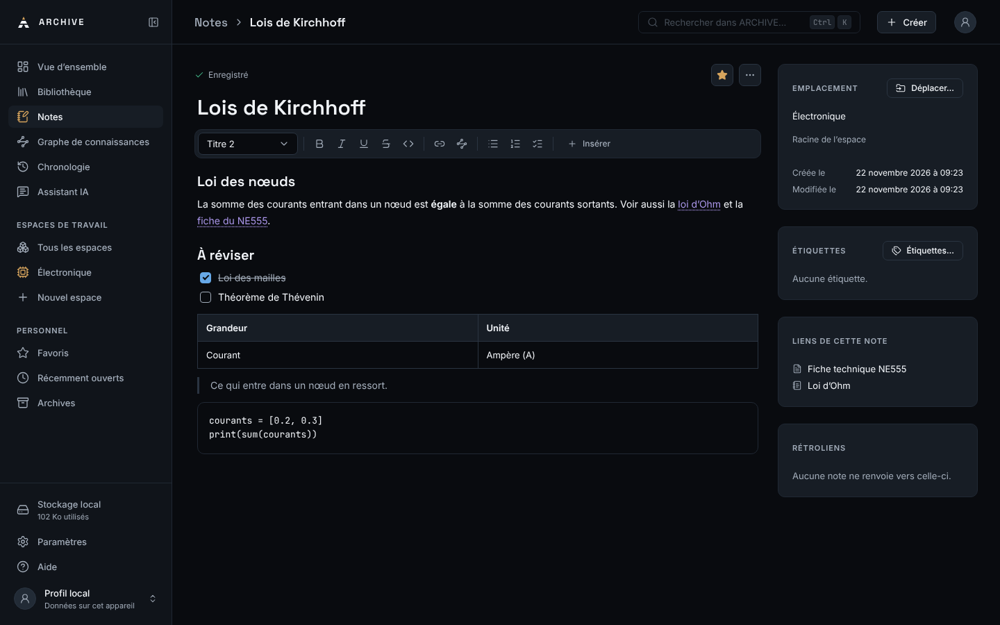
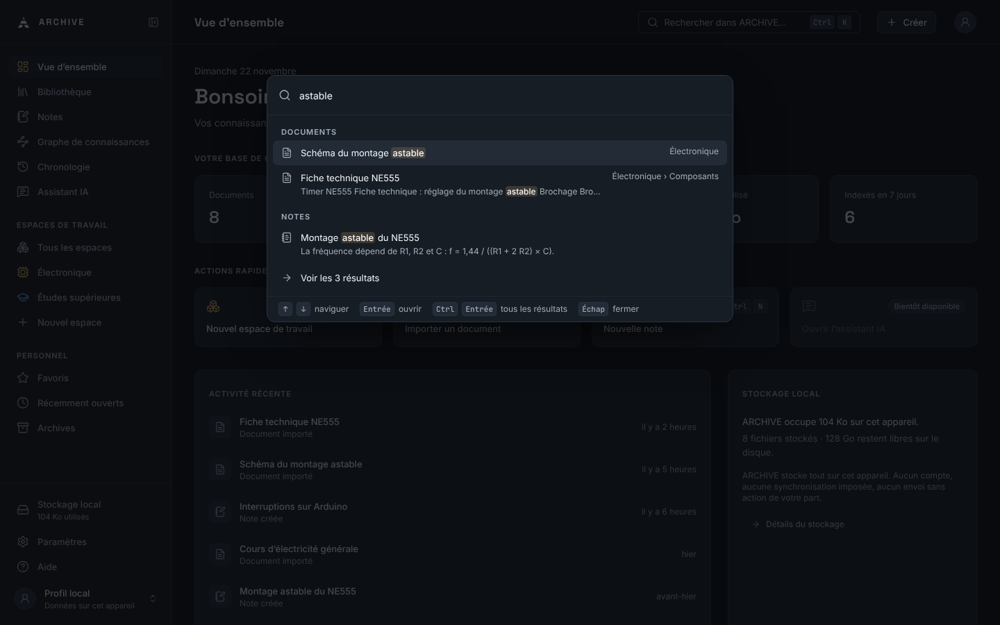

<p></p>

# ARCHIVE

**ARCHIVE — Your Second Brain.**
*Everything you know. Nothing forgotten.*

ARCHIVE est une application de bureau Windows de gestion des connaissances personnelles. Elle réunit les
documents, les notes et les idées de l'utilisateur dans un système structuré, interrogeable et relié, où les
informations s'organisent selon leur contenu, leurs relations et leur contexte.

- **Local d'abord** : les données restent sur la machine de l'utilisateur. Aucun service cloud n'est requis.
- **Recherche plein texte** dans le contenu des documents et des notes, insensible aux accents.
- **Relations et graphe de connaissances** : liens explicites, détectés ou suggérés, toujours sous le contrôle
  de l'utilisateur.
- **Assistant IA optionnel**, fondé sur les sources choisies par l'utilisateur, avec citations vérifiables.

## État du projet

**Phases 1 à 6 implémentées** : fondation et design system, base de données et stockage local, vue d'ensemble
et espaces de travail, Bibliothèque, Notes, recherche. On y importe ses documents (PDF, Word, texte, Markdown,
CSV, JSON, images) sans jamais toucher aux originaux, on y rédige des notes riches, enregistrées automatiquement,
reliées entre elles et aux documents, importables et exportables en Markdown, et on retrouve tout avec `Ctrl+K` :
recherche plein texte dans le contenu, insensible aux accents, avec extraits surlignés, filtres et historique.
Les modules suivants (moteur de mémoire, graphe, assistant…) arrivent phase par phase ; en attendant, leurs
écrans affichent un état vide honnête, sans contenu simulé.

Le développement suit 11 phases séquentielles (0 à 10), décrites dans le [cahier des charges](docs/SPECIFICATION.md).
L'avancement détaillé se trouve dans [DEVELOPMENT_PROGRESS.md](DEVELOPMENT_PROGRESS.md).





D'autres captures sont dans [docs/screenshots](docs/screenshots), rangées par phase.

## Fonctionnalités prévues

| Module | Phase |
|---|---|
| Shell de l'application et design system « Obsidian Knowledge Systems » | 1 |
| Base de données SQLite locale, migrations, stockage des fichiers | 2 |
| Vue d'ensemble et espaces de travail | 3 |
| Bibliothèque : import PDF, DOCX, TXT, MD, CSV, JSON et images ; aperçu, étiquettes, dossiers | 4 |
| Notes : éditeur riche, enregistrement automatique, liens internes, Markdown | 5 |
| Recherche globale (`Ctrl+K`) sur SQLite FTS5 | 6 |
| Moteur de mémoire : file de traitement, relations, provenance | 7 |
| Graphe de connaissances et chronologie | 8 |
| Assistant IA multi-fournisseur, avec citations | 9 |
| Sauvegarde, restauration, export, installateur Windows | 10 |

## Stack technique

Tauri 2 (Rust) · React 19 · TypeScript 6 · Vite 8 · Tailwind CSS 4 · Zustand · SQLite (FTS5) · TipTap ·
Cytoscape.js · Lucide. Le détail et les justifications sont dans [ARCHITECTURE.md](ARCHITECTURE.md).

## Prérequis

**Pour utiliser l'application** (dès qu'un installateur existera) : Windows 11, avec WebView2, présent par défaut.

**Pour développer** :
- Node.js ≥ 22.12 et npm
- Rust stable (≥ 1.85, édition 2024)
- Les [prérequis système de Tauri 2](https://v2.tauri.app/start/prerequisites/) de la plateforme. Sous
  Linux, la liste des paquets est dans [docs/ENVIRONMENT_AUDIT.md](docs/ENVIRONMENT_AUDIT.md), §4.

Le développement se fait entièrement dans des sessions cloud. Les installateurs Windows seront produits par
GitHub Actions : aucune machine locale n'est nécessaire pour compiler.

## Installation et commandes

### Obtenir l'application Windows sans rien compiler

Chaque build Windows de la CI (workflow **Windows build**, onglet *Actions* du dépôt) publie en artefact un
installateur NSIS (`ARCHIVE_x.y.z_x64-setup.exe`) et un installateur MSI. L'application n'est pas encore
signée : Windows SmartScreen peut afficher un avertissement à l'installation (la signature est traitée en
Phase 10).

### Développer

```bash
npm ci
```

```bash
npm run tauri dev
```

| Commande | Rôle |
|---|---|
| `npm run dev` | Interface seule dans un navigateur, sur http://localhost:1420 (les fonctions natives y sont indisponibles) |
| `npm run tauri dev` | Application de bureau complète, avec rechargement à chaud |
| `npm run tauri build` | Installateurs de production (MSI et NSIS sous Windows) |
| `npm run typecheck` · `npm run lint` · `npm run format:check` | Contrôles statiques |
| `npm test` | Tests unitaires et d'intégration (Vitest) |
| `npm run test:e2e` | Tests de bout en bout et d'accessibilité (Playwright et axe-core) |
| `npm run test:visual` | Captures d'audit visuel à trois résolutions, dans `visual-audit/` |
| `cargo fmt --check` · `cargo clippy --all-targets -- -D warnings` · `cargo test` | Contrôles du cœur natif (dossier `src-tauri/`) |
| `python3 scripts/validate-native-phaseN.py` | Validation de l'application de production réelle sous Xvfb (après `npm run tauri build -- --no-bundle`) |
| `python3 scripts/make-library-fixtures.py` | Régénère les fichiers de test de la Bibliothèque (`tests/fixtures/library/`) |

La galerie du design system est accessible en développement à l'adresse `#/dev/ui`.

## Structure du dépôt

```text
archive/
├── src/                       # Interface React : app/, components/, modules/, i18n/, services/, stores/, styles/
├── src-tauri/                 # Cœur natif Rust (commandes, configuration Tauri, icônes)
├── tests/e2e/                 # Tests Playwright : navigation, accessibilité, audit visuel
├── tests/fixtures/            # Fichiers de test réels (générés par scripts/make-library-fixtures.py)
├── scripts/                   # Validations natives et générateurs de fichiers de test
├── assets/brand/              # Logo et icône d'application (SVG sources)
├── docs/
│   ├── SPECIFICATION.md       # Cahier des charges maître (référence du périmètre)
│   ├── ENVIRONMENT_AUDIT.md   # Audit de l'environnement de développement
│   ├── DESIGN_SYSTEM.md       # Jetons, typographie, composants, règles d'interaction
│   └── screenshots/           # Captures de chaque phase
├── .github/workflows/         # CI Linux et build Windows
├── ARCHITECTURE.md            # Architecture et décisions techniques
├── DEVELOPMENT_PROGRESS.md    # Suivi de développement et prochaine action
├── CHANGELOG.md               # Journal des changements
├── CLAUDE.md                  # Consignes de reprise pour les sessions Claude Code
└── README.md
```

Le détail de la structure est décrit dans [ARCHITECTURE.md](ARCHITECTURE.md), §3.

## Licence

Dépôt privé, aucune licence accordée à ce stade. Tous droits réservés au porteur du projet.
